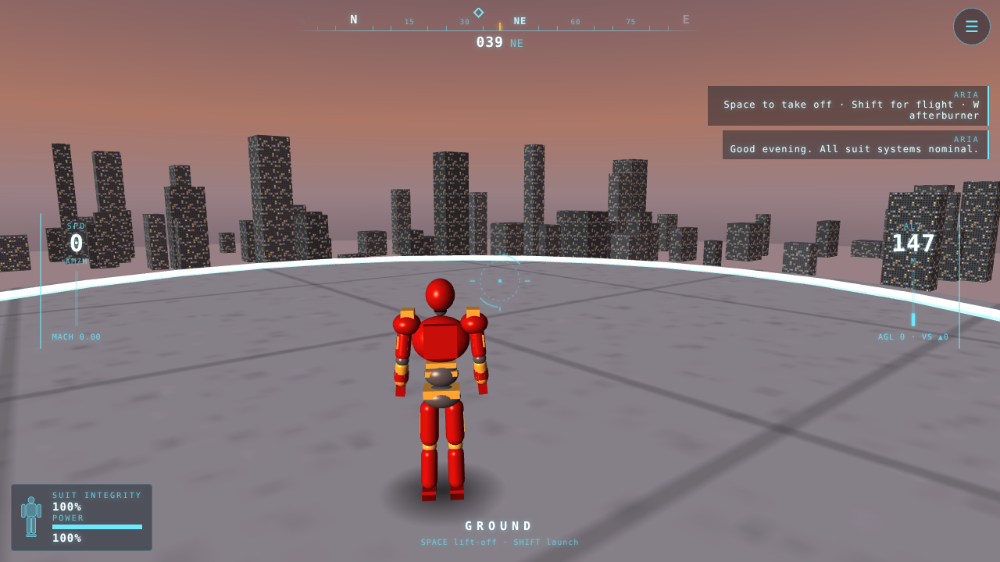
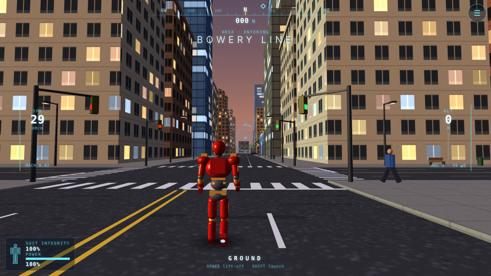
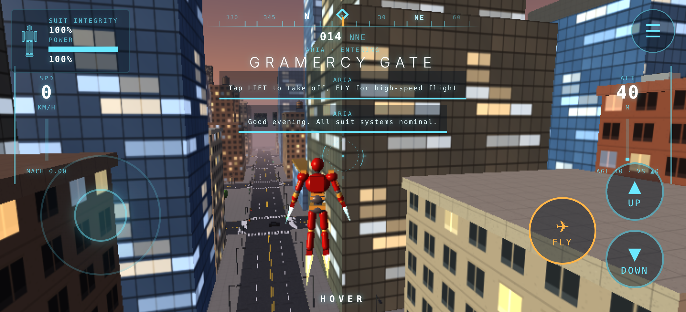

# AEGIS: Skyline Protocol

An original, browser-native 3D open-world superhero flight game. You pilot a red-and-gold powered-armour suit through a compact New York–inspired district at dusk, guided by **ARIA**, the suit's onboard AI.

Built with **Babylon.js + TypeScript + Vite**. Every model, texture and sound is generated procedurally at runtime, so there are no downloaded or proprietary assets. It builds to static files for **Cloudflare** (Workers static assets or Pages), at $0.

| | |
|---|---|
|  |  |
|  |  |

*These screenshots come from the real running game. They were captured in headless Chromium with software (SwiftShader) rendering via `npm run screenshots`. The mobile shot uses Chromium's iPhone emulation, not real Safari.*

## Milestone 1 – playable prototype

- **City district**: 4×4 chunks (8×8 blocks, about 680 m square) on an island, with avenues, lane markings, crosswalks, raised sidewalks, modular skyscrapers with setbacks and cornices, glass towers, NYC-style rooftop water towers, AC units, antennas, a park, a plaza with a fountain, and the hero landmark **Apex Tower** with its landing pad. A distant skyline and harbour water surround it.
- **Street life**: traffic that follows lanes, keeps its distance and stops at signals (the signals change colour), plus pedestrians walking the sidewalks.
- **Armoured hero**: a procedurally modelled suit with a joint hierarchy. Poses blend between walk, hover, flight and a "superhero landing" crouch, with boot and palm thruster flames, an arc reactor glow, a suit-up assembly animation on start, and a blob shadow.
- **Movement**: walking in armour, takeoff, hover (strafe, ascend, descend, hold altitude), high-speed flight with banking, an afterburner, braking back into hover, and landing on streets or rooftops (hard landings at speed). Wall impacts damage the suit. Stabilisers catch you if you walk off a roof, hover engages automatically over water, and soft limits apply to the airspace boundary and altitude ceiling.
- **Third-person camera**: smoothed follow, shoulder offset, speed-based distance and FOV, banking roll, impact shake, and pull-in when buildings get in the way.
- **ARIA HUD**: compass tape with map markers, heading, speed (km/h + Mach), altitude, AGL and vertical speed, suit integrity diagnostics (per-part silhouette), power bar, mode indicator, area-name banners, and dynamically generated alerts.
- **Optional city incidents**: ARIA spawns incidents nearby, each with a beam and ring in the world and an amber compass marker. Reach one to resolve it.
- **Controls**: keyboard and mouse (drag-look, or click to pointer-lock), plus a touch layout with a floating virtual stick, a camera drag area, and large UP / DOWN / FLY buttons.
- **Settings menu**: graphics quality (low / medium / high), auto-reduce quality on low FPS, mouse and touch sensitivity, invert Y, volume, FPS counter, and return to Apex Tower. Settings persist in `localStorage`.
- **Robustness**: loading screen with progress, a recoverable error screen when WebGL is unavailable, a WebGL context-loss notice, a rotate-to-landscape hint on phones, safe-area insets, and no pinch-zoom or scroll hijack.
- **Audio**: synthesised WebAudio thrusters, wind and alert blips (no audio files), unlocked by the Engage tap so it works on iOS.

## Controls

| Action | Keyboard / mouse | Touch |
|---|---|---|
| Move / strafe | `W A S D` / arrows | Left-thumb stick |
| Look / steer | Mouse (click to lock, `Esc` to release) | Drag on the right side |
| Take off / ascend (climb in flight) | `Space` (or `E`) | ▲ |
| Descend (dive in flight) | `C` (or `Q`, `Ctrl`) | ▼ |
| Toggle flight / hover | `Shift` or `F` | FLY |
| Afterburner / brake (in flight) | `W` / `S` | Stick up / down |
| Pause & settings | `Esc` or `P` | ☰ |

## Getting started

Requirements: Node.js 20+ (developed on Node 22).

```bash
npm install
npm run dev        # dev server with hot reload (http://localhost:5173, also on your LAN)
npm run build      # typecheck + production build into dist/
npm run preview    # serve dist/ at http://localhost:4173 (add --host to test from a phone on your Wi-Fi)
```

To test on a phone during development, run `npm run dev` and open the printed network URL on the phone (same Wi-Fi).

### Tests

```bash
npm test               # unit tests (Vitest): city generation, collision, flight physics
npm run test:e2e       # browser tests (Playwright + Chromium): boot, flight sequence, menu, touch, WebGL error
npm run screenshots    # regenerate docs/screenshots (SCREENSHOTS=1)
npm run typecheck      # app + test TypeScript projects
```

The e2e tests run the production build through `vite preview`. If Playwright has no browser installed, run `npx playwright install chromium` once.

## Deploying to Cloudflare (free)

The game is a fully static site: build command `npm run build`, output directory `dist`. Both Cloudflare options below are free.

**Option A: Workers with Git integration (Cloudflare's current default flow)**
1. In the Cloudflare dashboard, go to **Workers & Pages → Create → Import a repository** and pick this repo.
2. Build command: `npm run build`. Deploy command: `npx wrangler deploy` (the default).
3. Deploy. `wrangler.jsonc` in the repo tells Wrangler to serve `dist/` as static assets, so it does not try to auto-configure the Vite project. The Worker name in `wrangler.jsonc` (`ironman`) must match the Worker name in the dashboard; change one of them if you renamed the project.

**Option B: Pages with Git integration**
1. Go to **Workers & Pages → Create → Pages → Connect to Git** and pick the repo.
2. Framework preset **None** (or Vite), build command `npm run build`, build output directory `dist`. Optionally set the environment variable `NODE_VERSION=22`.

**Option C: Direct upload from your machine**
```bash
npm run build
npx wrangler deploy      # Workers static assets, using wrangler.jsonc
```
(Wrangler asks you to log in to your own Cloudflare account. No credentials are stored in this repo.)

`public/_headers` sets long-lived immutable caching for hashed assets and a few security headers (both Workers static assets and Pages honour it). Paths are relative (`base: "./"`), so the build also works from a sub-path.

## Architecture

```
src/
  main.ts                 boot: WebGL check, engine, loading/error UI
  core/                   Game loop & orchestration, Settings + quality presets, EventBus, math/RNG, device detection
  world/
    WorldConfig.ts        grid/chunk constants (grow the city by widening DISTRICT)
    CityGenerator.ts      pure, deterministic per-chunk layout data (buildings, props, colliders)
    ChunkManager.ts       turns chunk data into merged meshes, colliders, props; distance culling
    GeometryBatch.ts      merges boxes into one vertex buffer per material per chunk
    Materials.ts          shared materials with canvas-generated textures
    Props.ts              thin-instanced street furniture, rebuilt for chunks near the camera
    Traffic.ts / Pedestrians.ts   thin-instanced ambient life
    Environment.ts        lights, sky dome, fog, island, water, road markings, skyline
    Collision.ts          AABB spatial hash, ground heights, ray casts
  player/                 PlayerController (pure flight physics), ArmorModel (visuals/animation), SuitSystems
  camera/                 ThirdPersonCamera
  input/                  InputManager (keyboard/mouse/touch → InputState), TouchControls
  ui/                     Hud (ARIA HUD), SettingsMenu
  gameplay/               CityEvents (optional incidents / markers)
  audio/                  SuitAudio (synthesised)
```

Design notes for expansion:

- **Chunked, deterministic world.** `generateChunk(cx, cz)` is pure and seeded by coordinates. `ChunkManager.load/unload` already exist, so streaming a larger city means loading chunks by radius around the player. The collision world is a spatial hash, so its cost does not grow with city size.
- **Gameplay is decoupled from rendering.** `PlayerController`, `CityGenerator` and `CollisionWorld` have no rendering dependencies and are unit-tested in Node. Systems talk through a typed `EventBus` (alerts, mode changes, impacts, landings, area changes), which is where missions, abilities and the civilian alter ego will plug in.
- **The input abstraction** (`InputState`) is device-agnostic, so new abilities only need new fields and bindings.

### Performance approach

- Buildings merged into 3 draw calls per chunk. Props, cars and pedestrians use thin instances (1 draw call per part).
- Chunk meshes hidden beyond the view distance, and props only instanced within the prop distance. Opaque geometry is drawn front to back, with ground, water and sky last, to cut overdraw.
- Small canvas textures (512² facades, 256² others) with mipmaps. No post-processing. Transparency is limited to small additive effects.
- Real-time shadows only on **High** (player only). A blob shadow is used everywhere else.
- Quality presets control render resolution (pixel ratio), view and prop distances, shadows, particles, and car/pedestrian counts. Touch devices default to **Low**, desktops to **Medium**, and auto-reduce drops a level if FPS stays below about 26.

## Verification status

Verified in this environment (automated, headless Chromium 141 with SwiftShader software WebGL):
- Production build and TypeScript strict checks pass. 15 unit tests pass.
- The game boots with no console errors and loads all 16 chunks. Keyboard takeoff → hover → flight → afterburner → brake → landing works end to end.
- The pause menu changes quality, the change persists, and resume works.
- With Chromium's iPhone 13 landscape emulation (touch events): the touch UI appears, LIFT, the virtual stick and FLY work, the menu button opens settings, and Low quality is the default.
- The WebGL-unavailable error screen appears with Retry.
- The Engage button stays reachable on a 320×180 viewport.

**Not yet tested:**
- **Real iPhone Safari**, a real Chromebook, or any physical device or GPU. Mobile results above come from Chromium emulation, not WebKit.
- **Real-world frame rates.** SwiftShader renders on the CPU (about 8 fps at 640×360), so performance on real devices is unmeasured. The design targets integrated GPUs, but this needs on-device profiling.
- Audio output (the WebAudio graph is built, but nobody has listened to it), the pointer-lock experience, gamepads (not supported yet), and WebGL context-loss recovery.
- A full Cloudflare deployment. `npx wrangler deploy --dry-run` passes locally with `wrangler.jsonc`, but the real deploy has to run in your Cloudflare account.

## Roadmap (next milestones)

1. On-device profiling (iPhone Safari, Chromebook) and tuning of the quality presets.
2. Chunk streaming for a larger city with more district themes, bridges and landmarks.
3. Civilian alter ego with walking controls, plus the animated armour transformation between identities.
4. Abilities (repulsor blast, unibeam, scanner mode) with VFX and interactions.
5. Mission and event framework: chases, rescues, and timed flight challenges built on `CityEvents` and the `EventBus`.
6. Minimap, gamepad support, PWA offline caching.

## License

MIT for the code. All assets are generated at runtime by this code. This is an original work: no trademarked characters, names, logos or assets are used.
